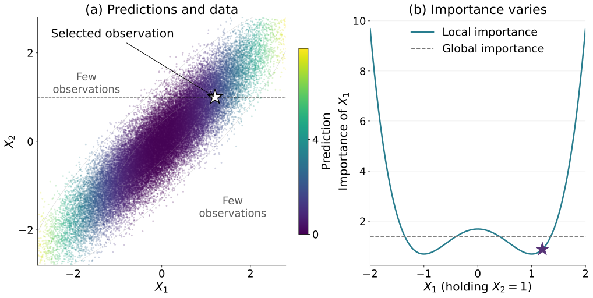
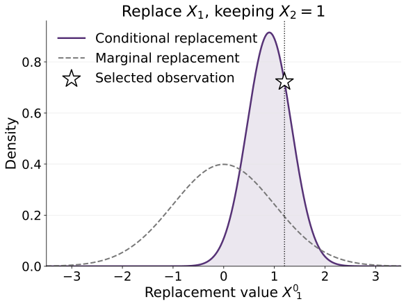
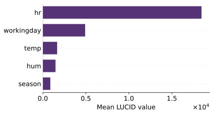
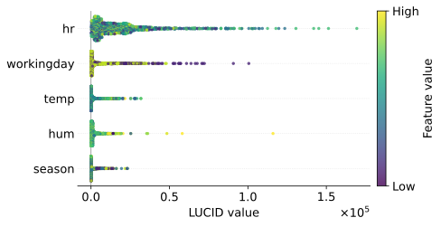
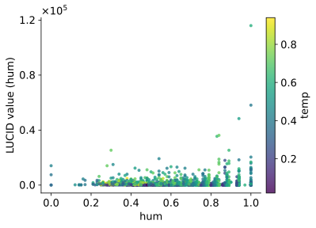
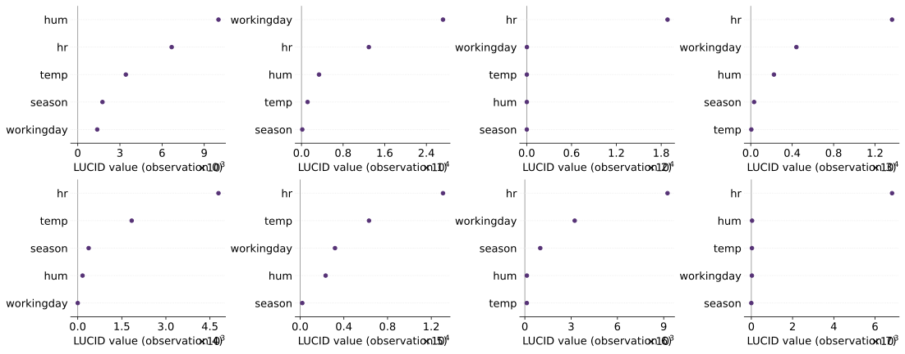

# Local Understanding of Covariate Importance with Conditional Density Estimation (LUCID)

**LUCID measures how much a model’s prediction depends on a feature for
a particular observation, while accounting for relationships between
features.** It holds the other features fixed, replaces the selected
feature with plausible values from its conditional distribution, and
averages the squared changes in prediction. 

## Why local and conditional importance?

Variable importance commonly assigns a single importance score to each
feature. However, understanding a model also requires knowing where a
feature matters and how strongly it affects individual predictions.
A global average can hide regions of both strong and weak local importance.

[](examples/figures/lucid_teaser_overview.pdf)

In this example, changing Feature 1 changes predictions, while changing
Feature 2 does nothing. Yet Feature 1’s importance varies across
observations, even with Feature 2 fixed. One global score cannot show that pattern.

**The replacement values matter, too.** The upper-left and lower-right
regions contain few observations. Replacements that ignore feature
dependence can create such unusual combinations, forcing the model to
extrapolate into regions where its behavior may be unreliable.

[](examples/figures/lucid_teaser_replacement.pdf)

At the star, we keep Feature 2 fixed and replace Feature 1 using its
conditional distribution. This respects the relationship between the
features. LUCID measures the resulting average squared prediction change,
revealing how much Feature 1 matters for this observation.

The example uses correlated Gaussian features and given predictive model `g(x) = x1²`. 

## What the package provides

LUCID provides observation-level importance for individual features and
feature groups. Averaging these values over evaluation observations gives
global importance summaries. DRBART-based samplers additionally support
posterior uncertainty estimates.

## Paper

This repository accompanies:

**Yixiao Wang, Srikar Katta, Jon Donnelly, Emanuele Borgonovo, and Cynthia Rudin.**
[LUCID: Local Understanding of Covariate Importance with Conditional Density Estimation](examples/figures/https://arxiv.org/abs/2610.35740).
arXiv:2610.35740, 2026.

## LUCID definition

For a given predictive model $g$, observation $x$, and feature $j$,
the prediction-based LUCID value is

```math
\mathrm{LUCID}_j(x) = \mathbb{E}\left[\left(g(X'_j,x_{-j})-g(x)\right)^2 \mid X_{-j}=x_{-j}\right].
```

Replacement values $X'_j$ are drawn from an estimated conditional distribution. Larger values indicate that plausible conditional replacements of the feature lead to greater changes in model predictions, suggesting that the feature provides unique predictive information beyond what is captured by the remaining features.

**This package provides several replacement samplers**, including
conditional distribution models based on TabPFN and DRBART, adversarial
random forests, conditional subgroup permutation, and conditional mean
residual methods. Marginal permutation is also available as a baseline.

`explanation.values` contains the LUCID value for each evaluation observation and selected feature.

 `explanation.global_importance()` averages these values across evaluation observations to obtain CPFI.


The background data determine the distributions used for replacement. They usually come from the predictive model's training data. Evaluation data identify the observations to explain.

If you are familiar with SHAP, LUCID follows a similar workflow:

```python
# SHAP
explainer = shap.Explainer(model, X_background)
explanation = explainer(X_eval)

# LUCID
explainer = lucid.Explainer(model, X_background, sampler="cmr")
explanation = explainer(X_eval)
```

Both return explanation objects with a `.values` attribute, but the values
measure different quantities: SHAP provides additive feature attributions,
whereas LUCID measures prediction sensitivity under feature replacement.

## Installation

LUCID requires Python 3.12 or newer. The package has been tested on
Python 3.14.

Clone the repository and install LUCID:

```bash
git clone https://github.com/Yixiao-Wang-Stats/LUCID_competition.git
cd LUCID_competition

python -m pip install .
```

Install optional dependencies for the samplers you intend to use:

```bash
# Local TabPFN
python -m pip install ".[tabpfn]"

# Hosted TabPFN
python -m pip install ".[hosted]"

# Python Bayesian components used by DRBART
python -m pip install ".[bayesian]"

# XGBoost conditional mean models for CMR and GCMR
python -m pip install ".[xgboost]"
```

The quick start examples below use an XGBoost predictor:

```bash
python -m pip install ".[xgboost]"
```

R-backed samplers require additional dependencies. See [R setup](#r-setup).

## Quick start

Load Bike Sharing, fit a predictive model, and explain held-out observations.
This small example uses 1,000 training observations and 20 evaluation
observations.

```python
from sklearn.model_selection import train_test_split
from xgboost import XGBRegressor

import lucid

X, y = lucid.datasets.bikesharing()
X_train, X_eval, y_train, _ = train_test_split(
    X, y,
    train_size=1000,
    test_size=20,
    random_state=2026,
)

model = XGBRegressor(random_state=2026)
model.fit(X_train, y_train)

feature_types = [
    "categorical" if name in {"hr", "season"}
    else "binary" if name == "workingday"
    else "continuous"
    for name in X.columns
]

explainer = lucid.Explainer(
    model,
    X_train,
    sampler="cmr",
    feature_types=feature_types,
    random_state=2026,
    # To use TabPFN after completing its setup, replace sampler="cmr" with:
    # sampler="tabpfn",
    # sampler_kwargs={"version": "v3.5-fast"},
)

try:
    explanation = explainer(
        X_eval,
        features=["temp", "hum"],
        n_resamples=1000,
    )
finally:
    explainer.close()

print(explanation.values)
print(explanation.global_importance())
```

The output has shape `(20, 2)`: one row per evaluation observation and
one column per selected feature.

Omit `features` to explain all features. Set `n_jobs` in the constructor
to control concurrent feature tasks.

The model may be a fitted estimator with a `predict` method or a prediction
callable. It must produce one numeric prediction per observation.
Categorical input features must be represented numerically and identified
through `feature_types`.

For local TabPFN 3.5/3.5-Fast sampling on CPU, background datasets larger
than 5,000 rows are blocked by default to avoid slow execution. Use a
smaller background, a GPU, or hosted sampling; to override the guard, set
`ignore_pretraining_limits=True` in `sampler_kwargs` or
`TABPFN_ALLOW_CPU_LARGE_DATASET=1`. See [TabPFN setup](#tabpfn-setup).

## Samplers

Select the replacement method through `sampler`.

| Sampler | Replacement method | Additional requirements |
|---|---|---|
| `tabpfn` | TabPFN conditional predictions | `tabpfn` or `hosted` extra |
| `drbart` | Continuous density regression and categorical BART | `bayesian` extra, R, and R dependencies |
| `arf` | Adversarial random forest | R and `arf` |
| `cspfi` | Conditional subgroup permutation | R, `mlt`, `partykit`, and `trtf` |
| `cmr` | Conditional mean residual resampling | `xgboost` extra for the default mean model |
| `gcmr` | Gaussian conditional mean residual resampling | `xgboost` extra for the default mean model |
| `permutation` | Marginal feature resampling | Basic installation |

Sampler-specific options belong in `sampler_kwargs`. The number of
replacement draws, `n_resamples`, belongs in the explanation call.

## Sampler references

LUCID uses the following methods and software for feature replacement.
When reporting results, cite LUCID and the references relevant to the
samplers and model versions used.

| Sampler | References |
|---|---|
| TabPFN | Version-specific references listed below |
| DRBART | [Orlandi et al. (2021)](https://arxiv.org/abs/2112.12259) |
| ARF | [Watson et al. (2023)](https://proceedings.mlr.press/v206/watson23a.html); [Blesch et al. (2025)](https://doi.org/10.1609/aaai.v39i15.33712) |
| CSPFI | [Molnar et al. (2024)](https://doi.org/10.1007/s10618-022-00901-9) |
| CMR | [Fisher et al. (2019)](https://jmlr.org/papers/v20/18-760.html); [Chamma et al. (2023)](https://arxiv.org/abs/2309.07593) |
| GCMR | [Borgonovo et al. (2026)](https://arxiv.org/abs/2604.11253) |

CMR and GCMR are implemented within LUCID using residual resampling
in the original and Gaussianized feature spaces, respectively.
These references describe the underlying constructions; the implementations
use LUCID's background-data and sampling interfaces.

For binary and categorical features, the DRBART sampler uses BART models
implemented with [PyMC-BART](https://www.pymc.io/projects/bart/en/latest/).

### TabPFN versions

Please cite the paper or technical report associated with the model
version used:

- **v2:** Hollmann et al. (2025),
  [Accurate predictions on small data with a tabular foundation model](https://doi.org/10.1038/s41586-024-08328-6).
- **v2.5:** Grinsztajn et al. (2025),
  [TabPFN-2.5: Advancing the State of the Art in Tabular Foundation Models](https://arxiv.org/abs/2511.08667).
- **v2.6:** Identify the exact checkpoint release and follow its
  model-card citation guidance. See the
  [upstream TabPFN documentation](https://github.com/PriorLabs/TabPFN).
- **v3:** Grinsztajn et al. (2026),
  [TabPFN-3: Technical Report](https://arxiv.org/abs/2605.13986).
- **v3.5 and v3.5-fast:** Jäger et al. (2026),
  [TabPFN-3.5: Technical Report](https://arxiv.org/abs/2609.17895).

For complete BibTeX entries, see the
[upstream citation instructions](https://github.com/PriorLabs/TabPFN#citation).

### TabPFN setup

For local execution, TabPFN downloads its pretrained weights on first use
and stores them in its user cache. Follow the
[TabPFN authentication and license instructions](https://github.com/PriorLabs/TabPFN#-faq).

LUCID does not bundle pretrained TabPFN weights or authentication tokens.

The default device selection is automatic. Select a device explicitly
through `sampler_kwargs`:

```python
sampler_kwargs={
    "version": "v3.5-fast",
    "backend": "local",
    "device": "cuda",
}
```

For offline execution, download the checkpoint beforehand and provide
`model_path`, or configure TabPFN's model cache directory.

For hosted execution, install the `hosted` extra, configure your own
TabPFN client authentication, and use:

```python
sampler_kwargs={
    "version": "v3.5-fast",
    "backend": "hosted",
}
```

Hosted execution sends data to the external service. Refer to the provider's
documentation for service terms and data handling.

### R setup

DRBART, ARF, and CSPFI require an R installation with `Rscript` available
on the system path. Install R using the instructions for your operating
system from [CRAN](https://cran.r-project.org/).

Verify the installation:

```bash
Rscript --version
```

Install the packages needed by the R-backed samplers in an R session:

```r
install.packages(
    c("arf", "mlt", "partykit", "trtf", "truncnorm", "remotes"),
    repos = "https://cloud.r-project.org"
)

# install.packages("devtools")
devtools::install_github('vittorioorlandi/drbart', ref = 'main')
```

Building packages from source may require compilers and development
libraries. Follow the upstream package instructions for your platform.

If you use a custom R library, configure `R_LIBS_USER` before starting
Python. The Python installation does not install R or its packages.

Windows users: Installing R packages from source may require Rtools, which provides the necessary compilation tools.

## Feature-group importance

Use `GroupExplainer` to replace several features jointly. Group sampling
is available with TabPFN and DRBART.

Group importance measures how predictions change when a group is replaced
conditional on the features outside that group. It can reveal shared
predictive information that individual conditional importance may miss
when group members strongly predict one another.

```python
explainer = lucid.GroupExplainer(
    model,
    X_train,
    sampler="tabpfn",
    feature_types=feature_types,
    random_state=2026,
    sampler_kwargs={"version": "v3.5-fast"},
)

try:
    group_explanation = explainer(
        X_eval,
        groups={
            "weather": ["temp", "hum", "season"],
            "calendar": ["hr", "workingday", "season"],
        },
        n_resamples=1000,
    )
finally:
    explainer.close()

print(group_explanation.values)
print(group_explanation.global_importance())
```

Each output column represents one named group. Group values are computed
by joint replacement; they are not sums of individual feature values.

Groups may overlap. Member order determines the sequential conditional
sampling order. `n_jobs` controls concurrent group tasks.

## Posterior uncertainty

`UncertaintyExplainer` uses posterior draws from fitted DRBART/BART
conditional models. The predictive model remains fixed.

```python
explainer = lucid.UncertaintyExplainer(
    model,
    X_train,
    sampler="drbart",
    feature_types=feature_types,
    random_state=2026,
)

try:
    uncertainty = explainer(
        X_eval.iloc[:3],
        features=["hum"],
        n_posterior_draws=100,
        n_resamples=1000,
    )
finally:
    explainer.close()

lower, upper = uncertainty.credible_interval(level=0.95)
global_lower, global_upper = uncertainty.global_credible_interval(level=0.95)
```

`n_posterior_draws` selects the number of conditional-model posterior draws.
`n_resamples` controls replacement draws for each posterior draw and
evaluation observation.

These intervals describe conditional-model posterior uncertainty with the
predictive model held fixed. Finite resampling also introduces Monte Carlo
variation. They do not account for uncertainty from retraining the
predictive model.

See [the Auto MPG uncertainty example](examples/uncertainty.py).
Group uncertainty is available through `GroupUncertaintyExplainer`.

## Plots

Plot functions return Matplotlib axes for further customization.

```python
import matplotlib.pyplot as plt

lucid.plots.bar(explanation)

lucid.plots.beeswarm(
    explanation,
    X_eval,
    categorical=["hr", "workingday", "season"],
    cmap="viridis",
)

lucid.plots.scatter(
    explanation,
    X_eval,
    feature="hum",
    color="temp",
    cmap="viridis",
)

lucid.plots.observations(
    explanation,
    observations=range(8),
    ncols=4,
)

plt.show()
```

The figures below use an XGBoost predictor and local TabPFN 3.5-Fast
sampling on Bike Sharing: 6,916 background observations, all 1,729 held-out
evaluation observations, and 1,000 replacement draws per feature. The
observation panels show the first eight evaluation rows. Click a figure
to open its PDF.

**Global importance over the evaluation observations**

[](examples/figures/bikesharing_bar.pdf)

**Observation-level importance distributions**

[](examples/figures/bikesharing_beeswarm.pdf)

**Humidity importance, colored by temperature**

[](examples/figures/bikesharing_scatter.pdf)

**Individual explanations for eight observations**

[](examples/figures/bikesharing_observations.pdf)

The rows of `X_eval` must match the explanation rows in order.

`lucid.plots.relationship` combines a feature-correlation display with
LUCID distributions. Its default links represent Pearson correlations;
they are not estimated conditional predictability scores.

See the [introductory notebook](examples/introduction.ipynb) for all plots
and group visualizations.

## Datasets and examples

Bundled datasets return a pandas feature DataFrame and target Series:

```python
X, y = lucid.datasets.bikesharing()
X, y = lucid.datasets.auto_mpg()
X, y = lucid.datasets.dgp.extreme_tail()
```

The bundled real datasets are prepared versions of
[Bike Sharing](https://archive.ics.uci.edu/dataset/275/bike+sharing+dataset)
and [Auto MPG](https://archive.ics.uci.edu/dataset/9/auto+mpg).
They are not necessarily identical to the original source files.

| Example | Contents |
|---|---|
| [Basic usage](examples/basic_usage.py) | Bike Sharing feature importance and plots |
| [Group importance](examples/group_importance.py) | Joint importance of feature groups |
| [Uncertainty](examples/uncertainty.py) | Auto MPG with DRBART posterior intervals |
| [Introduction](examples/introduction.ipynb) | Calculation and visualization walkthrough |

## Intermediate files

Some samplers write fitted models and exchange files.

By default, LUCID uses a system temporary directory. Call
`explainer.close()` when finished to release its temporary workspace.

To retain intermediate files, provide an explicit directory:

```python
explainer = lucid.Explainer(
    model,
    X_train,
    sampler="drbart",
    feature_types=feature_types,
    output_dir="outputs/drbart",
)
```

An explicitly supplied output directory is retained after `close()`.
Explanation values remain available in the returned explanation object.

## Citation

If you use LUCID in your research, please cite:

```bibtex
@misc{wang2026lucid,
  title = {{LUCID}: Local Understanding of Covariate Importance
           with Conditional Density Estimation},
  author = {Wang, Yixiao and Katta, Srikar and Donnelly, Jon and Borgonovo, Emanuele and Rudin, Cynthia},
  year = {2026},
  eprint = {2610.35740},
  archivePrefix = {arXiv},
  primaryClass = {cs.LG},
  url = {https://arxiv.org/abs/2610.35740}
}
```

## Questions and issues

Please report bugs and usage questions through
[GitHub Issues](https://github.com/Yixiao-Wang-Stats/LUCID_competition/issues).

Include your LUCID version, Python version, operating system, sampler,
and a minimal reproducible example. For R-backed samplers, include the
R version and relevant R package versions.

## License

LUCID is distributed under the [MIT License](LICENSE).

The accompanying paper is distributed under the license specified on its
[arXiv record](https://arxiv.org/abs/2610.35740).

Third-party dependencies, pretrained models, hosted services, and bundled
datasets are subject to their respective licenses and terms.
